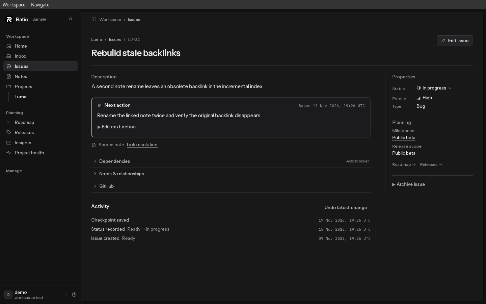

# Ratio desktop

Ratio opens a dedicated application window on Windows and Linux. Each installation keeps its own sign-in profile. Both use the same workspace records when connected to the same HTTPS deployment as the same account. The server owns the projects, issues, notes, release history and entitlements; copying a database between machines is unnecessary.

## Install

Download the appropriate package from the [private releases](https://github.com/MimoAlexer/ratio/releases). The release contains SHA256SUMS for both installers.

- **Windows x64:** run the setup EXE. It installs for the current user and adds Ratio to the Start menu. Microsoft Edge WebView2 Evergreen is required. If it is missing, follow the installer’s instructions or install the [official Microsoft WebView2 runtime](https://developer.microsoft.com/microsoft-edge/webview2/). The release is unsigned.
- **Ubuntu / Debian x86-64** — from the directory containing the downloaded package, run `sudo apt install ./ratio_0.3.1_amd64.deb`. APT installs GTK 3 and WebKitGTK 4.1 as needed. Launch **Ratio** from the applications menu or run `ratio`.

## Upgrading

Close the app and install 0.3.1 over Ratio 0.3.0, 0.2.1, 0.2.0, 0.1.1, or Working Set 0.1.0. Ratio reuses your saved server address and sign-in profile. A new installation starts in a private Ratio data directory. The workspace interface comes from the server you connect to. Self-hosted installations need the 0.3.1 server for the updated Home view.

## Connect two computers

1. On the first computer, enter the origin of your backend, for example `https://your-deployment.example`. Use the exact same address on the second.
2. Begin desktop sign-in. Ratio shows a device code. In your system browser, sign in to the intended account, check the code and approve.
3. Return to the application, check approval and confirm the displayed email. Your signed-in window opens Home.
4. Repeat on the other computer. While a desktop window is visible, it checks for changes about every ten seconds and when you return to it. A clean view refreshes. With a draft in progress, **Load updates** lets you choose when to refresh. A separate account at the same address still has its own private data.

The local demo uses `http://127.0.0.1:4178` on the machine running the bundled development setup. On a different machine, that address points to the different machine itself. Use a shared reachable HTTPS server for real cross-device work. This is a connected desktop client: an unreachable server offers retry and connection settings. When offline, the app preserves a typed draft for an explicit retry; it does not send a change in the background.

## Desktop behavior

- Desktop and website sessions are independent; approving the desktop creates a separate session. Use **Settings** to manage sessions.
- Connection settings and WebView profiles are stored in the current OS user’s application-data directory. Each distinct origin receives its own profile. Uninstalling preserves local preferences and profiles. Signing out revokes the server session.
- Ordinary operations and same-origin screens stay in the application. Approved external HTTPS links open in the system browser. Arbitrary HTTP and mail links in notes can be copied manually.
- ZIP downloads use the native save dialog and preserve an existing destination file. Sensitive temporary export files are deleted after completion or cancellation.
- Select the **Desktop controls** button or press **F10** to open the native menu. Use **Alt+Left** and **Alt+Right** for history, **Ctrl+R** to reload, **Ctrl+,** for connection settings, and **Ctrl+Q** to quit.

## The workspace

Home opens first. Open Issues from the sidebar to filter, group or sort records, or switch to Board. Select an issue to preview its next action. Choose **Open issue** in the preview to read the full record. The theme control switches between graphite and pure monochrome.



[Desktop qualification and checksums](../docs/desktop-verification.md)

## Build and test

The native client is a separate Rust Cargo package. The server can be deployed to Railway using [the operations guide](../ops/railway.md).

```sh
cargo test --locked --manifest-path desktop/Cargo.toml
cargo build --release --locked --manifest-path desktop/Cargo.toml
```

On Ubuntu, building from source requires the GTK 3 and WebKitGTK 4.1 development packages in addition to the Rust toolchain. Windows native builds use Visual Studio C++ Build Tools and a Windows SDK. The cross-build can also target Windows GNU. The release includes the required WebView2 loader library for the GNU build. Native CI and packaging recipes are in [the desktop workflow](../.github/workflows/desktop.yml) and [packaging](packaging).

`ratio --server https://your-deployment.example` selects a server directly. `--profile-dir <directory>` runs with a separate set of local profiles for testing. HTTP is accepted only on a loopback address.
