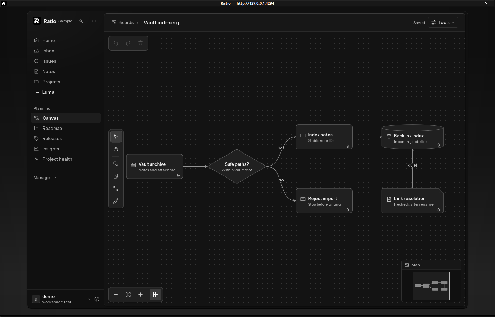

# Planning canvas

Open **Canvas** in the sidebar, choose a project, and create a board. The blank board gives you a dotted drawing surface. Architecture, Release and Decision templates start with connected shapes you can change. Every plan includes Canvas.

## Draw and connect

Choose **Shapes** to place a process, decision, service or database. Choose a note for text or the pen for a freehand line. With the select tool, click a shape to edit its label or body and drag it to move it. Choose **Connect**, then select the starting shape and its destination. Select the connector to name it.

Use **Snap to grid** for precise placement and **Tools → Tidy layout** to arrange a connected diagram. The minimap lets you jump across a large board. **Fit** brings the drawing back into view. With the stage focused, bracket keys select the previous or next object. Arrow keys move a selected shape. Open keyboard help for the other drawing shortcuts.

## Plan with your project

- **Link issue or note** attaches a real project record to the selected shape. Open the link to read or update the original record.
- **Trace upstream** highlights the selected shape’s prerequisites. **Trace downstream** follows the direction of its outgoing connections. **Clear trace** returns to the full map.
- **Find on canvas** locates a shape by its text and moves the view to it.
- **Undo** and **Redo** step through edits in the current session. **Tools → Checkpoints** names a saved version that you can restore on another device. Restoring also keeps a recovery copy of the drawing you just left.
- **Export SVG** downloads a standalone image. A project ZIP also carries the editable board and its checkpoint history. [Project transfer](transfers.md)

A board and its saved checkpoints count toward workspace storage. Saving a checkpoint retains a full copy of the drawing. You can delete a named checkpoint from **Tools → Checkpoints** to free its space. Ratio keeps the five most recent automatic recovery copies per board. If a restore would exceed your limit, the current drawing and checkpoints stay intact.

Changes save to your account. If another device saves first, the editor keeps your local draft and offers a recovery choice. An archived project’s board opens for reading. With JavaScript disabled, you can read the diagram and its linked records in the outline. Desktop SVG saving uses Ratio 0.4.0 or later.
