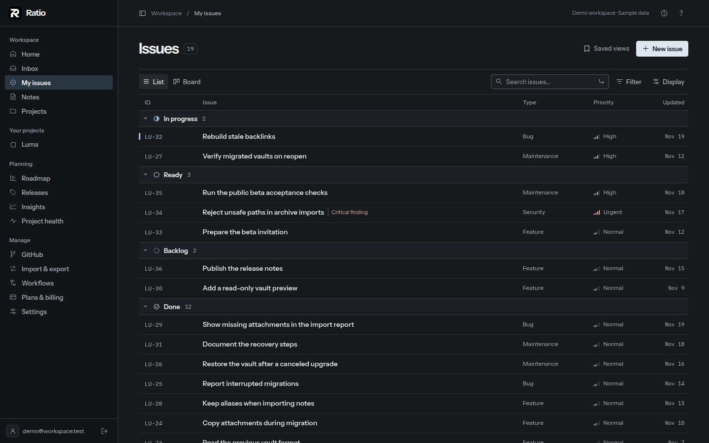
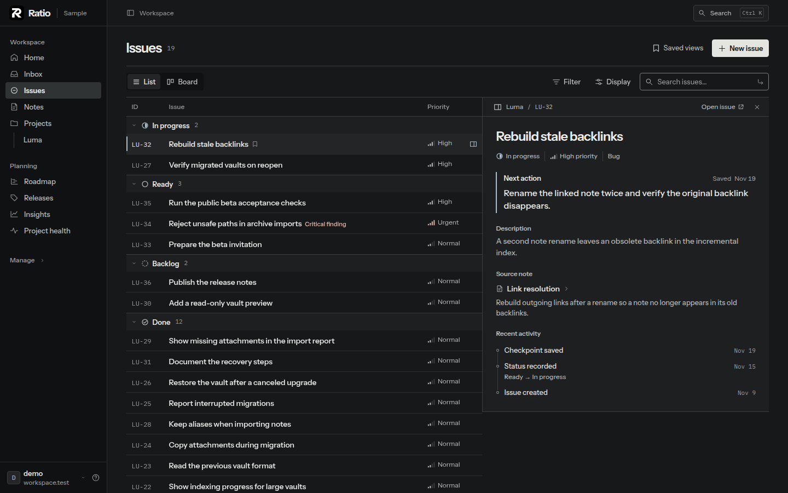

# Ratio 0.2 visual evidence

The [interactive review](review.html) opens locally when downloaded with its images directory. Use the direct image links below in GitHub. Each lossless WebP retains every RGB pixel and the dimensions of its source capture.

## The issue workbench

| Original, 1440 × 900 | Final, 1440 × 900 |
| --- | --- |
|  |  |

The original register used the available desktop width for issue rows. The final workbench gives the selected issue its own inspector. On the phone the full register remains available, and opening a preview takes the reader into the selected record.

## Workflow comparisons

| State | Original | Final | What to inspect |
| --- | --- | --- |
| Home on a phone | [Original](images/home/390-original.webp) | [Final](images/home/390-release.webp) | The saved instruction for LU-32 and the place of critical findings in the queue. |
| New issue on desktop | [Original](images/issue-new/1440-original.webp) | [Final](images/issue-new/1440-release.webp) | List position, title focus, and the separation between the form and issue records. |
| Empty workspace | [Original](images/empty-issues/1280-original.webp) | [Final](images/empty-issues/1280-release.webp) | The first available action for someone with no project. |
| Dense list on a phone | [Original](images/dense-issues/390-original.webp) | [Final](images/dense-issues/390-release.webp) | The 137-character title, its status, and the alignment of the rows below. |
| Desktop connection window | [Original](images/native-connection-before.png) | [Updated](images/native-connection-after.png) | These 1280 × 800 PNGs show the native launcher. |

## Product captures

The populated workspace uses the seeded Luma records. The empty workspace, 25-issue Relay runtime dataset, and form recovery states use isolated test fixtures. Each link opens a complete browser viewport at device pixel ratio 1. The preview and command menu first appeared in C1.

### Workspace

| Screen | 1440 × 900 | 1280 × 800 | 390 × 844 |
| --- | --- | --- | --- |
| Issue workbench | [Original](images/issues/1440-original.webp) · [C1](images/issues/1440-c1.webp) · [C2](images/issues/1440-c2.webp) · [C3](images/issues/1440-release.webp) · [Release](images/issues/1440-release.webp) | [Original](images/issues/1280-original.webp) · [C1](images/issues/1280-c1.webp) · [C2](images/issues/1280-c2.webp) · [C3](images/issues/1280-c3.webp) · [Release](images/issues/1280-release.webp) | [Original](images/issues/390-original.webp) · [C1](images/issues/390-c1.webp) · [C2](images/issues/390-c2.webp) · [C3](images/issues/390-release.webp) · [Release](images/issues/390-release.webp) |
| Selected issue preview | — | [C1](images/issue-preview/1280-c1.webp) · [C2](images/issue-preview/1280-c2.webp) · [C3](images/issue-preview/1280-release.webp) · [Release](images/issue-preview/1280-release.webp) | [C1](images/issue-preview/390-c1.webp) · [C2](images/issue-preview/390-c2.webp) · [C3](images/issue-preview/390-release.webp) · [Release](images/issue-preview/390-release.webp) |
| Issue detail | [Original](images/issues-detail/1440-original.webp) · [C1](images/issues-detail/1440-c1.webp) · [C2](images/issues-detail/1440-c2.webp) · [C3](images/issues-detail/1440-release.webp) · [Release](images/issues-detail/1440-release.webp) | [Original](images/issues-detail/1280-original.webp) · [C1](images/issues-detail/1280-c1.webp) · [C2](images/issues-detail/1280-c2.webp) · [C3](images/issues-detail/1280-release.webp) · [Release](images/issues-detail/1280-release.webp) | [Original](images/issues-detail/390-original.webp) · [C1](images/issues-detail/390-c1.webp) · [C2](images/issues-detail/390-c2.webp) · [C3](images/issues-detail/390-c3.webp) · [Release](images/issues-detail/390-release.webp) |
| Home | [Original](images/home/1440-original.webp) · [C1](images/home/1440-c1.webp) · [C2](images/home/1440-c2.webp) · [C3](images/home/1440-release.webp) · [Release](images/home/1440-release.webp) | [Original](images/home/1280-original.webp) · [C1](images/home/1280-c1.webp) · [C2](images/home/1280-c2.webp) · [C3](images/home/1280-release.webp) · [Release](images/home/1280-release.webp) | [Original](images/home/390-original.webp) · [C1](images/home/390-c1.webp) · [C2](images/home/390-c2.webp) · [C3](images/home/390-release.webp) · [Release](images/home/390-release.webp) |
| Issue board | — | [Original](images/issues-board/1280-original.webp) · [C1](images/issues-board/1280-c1.webp) · [C2](images/issues-board/1280-c2.webp) · [C3](images/issues-board/1280-release.webp) · [Release](images/issues-board/1280-release.webp) | [Original](images/issues-board/390-original.webp) · [C1](images/issues-board/390-c1.webp) · [C2](images/issues-board/390-c2.webp) · [C3](images/issues-board/390-release.webp) · [Release](images/issues-board/390-release.webp) |
| Project detail | [Original](images/projects-detail/1440-original.webp) · [C1](images/projects-detail/1440-c1.webp) · [C2](images/projects-detail/1440-c2.webp) · [C3](images/projects-detail/1440-release.webp) · [Release](images/projects-detail/1440-release.webp) | — | [Original](images/projects-detail/390-original.webp) · [C1](images/projects-detail/390-c1.webp) · [C2](images/projects-detail/390-c2.webp) · [C3](images/projects-detail/390-release.webp) · [Release](images/projects-detail/390-release.webp) |
| Note detail | [Original](images/notes-detail/1440-original.webp) · [C1](images/notes-detail/1440-c1.webp) · [C2](images/notes-detail/1440-c2.webp) · [C3](images/notes-detail/1440-release.webp) · [Release](images/notes-detail/1440-release.webp) | — | [Original](images/notes-detail/390-original.webp) · [C1](images/notes-detail/390-c1.webp) · [C2](images/notes-detail/390-release.webp) · [C3](images/notes-detail/390-release.webp) · [Release](images/notes-detail/390-release.webp) |
| Roadmap | [Original](images/roadmap/1440-original.webp) · [C1](images/roadmap/1440-c1.webp) · [C2](images/roadmap/1440-c2.webp) · [C3](images/roadmap/1440-release.webp) · [Release](images/roadmap/1440-release.webp) | — | [Original](images/roadmap/390-original.webp) · [C1](images/roadmap/390-c1.webp) · [C2](images/roadmap/390-c2.webp) · [C3](images/roadmap/390-release.webp) · [Release](images/roadmap/390-release.webp) |
| Release review | — | [Original](images/releases-detail/1280-original.webp) · [C1](images/releases-detail/1280-c1.webp) · [C2](images/releases-detail/1280-c2.webp) · [C3](images/releases-detail/1280-release.webp) · [Release](images/releases-detail/1280-release.webp) | — |
| Workspace settings | — | [Original](images/settings/1280-original.webp) · [C1](images/settings/1280-c1.webp) · [C2](images/settings/1280-c2.webp) · [C3](images/settings/1280-c3.webp) · [Release](images/settings/1280-release.webp) | [Original](images/settings/390-original.webp) · [C1](images/settings/390-c1.webp) · [C2](images/settings/390-c2.webp) · [C3](images/settings/390-c3.webp) · [Release](images/settings/390-release.webp) |

### Interactions

| Screen | 1440 × 900 | 1280 × 800 | 390 × 844 |
| --- | --- | --- | --- |
| Open issue filters | — | [Original](images/filter/1280-original.webp) · [C1](images/filter/1280-c1.webp) · [C2](images/filter/1280-c2.webp) · [C3](images/filter/1280-c3.webp) · [Release](images/filter/1280-release.webp) | [Original](images/filter/390-original.webp) · [C1](images/filter/390-c1.webp) · [C2](images/filter/390-c2.webp) · [C3](images/filter/390-c3.webp) · [Release](images/filter/390-release.webp) |
| Command search | [C1](images/command-dialog/1440-c1.webp) · [C2](images/command-dialog/1440-c2.webp) · [C3](images/command-dialog/1440-release.webp) · [Release](images/command-dialog/1440-release.webp) | [C1](images/command-dialog/1280-c1.webp) · [C2](images/command-dialog/1280-c2.webp) · [C3](images/command-dialog/1280-release.webp) · [Release](images/command-dialog/1280-release.webp) | [C1](images/command-dialog/390-c1.webp) · [C2](images/command-dialog/390-c2.webp) · [C3](images/command-dialog/390-release.webp) · [Release](images/command-dialog/390-release.webp) |
| New issue | [Original](images/issue-new/1440-original.webp) · [C1](images/issue-new/1440-c1.webp) · [C2](images/issue-new/1440-c2.webp) · [C3](images/issue-new/1440-release.webp) · [Release](images/issue-new/1440-release.webp) | — | [Original](images/issue-new/390-original.webp) · [C1](images/issue-new/390-c1.webp) · [C2](images/issue-new/390-c2.webp) · [C3](images/issue-new/390-release.webp) · [Release](images/issue-new/390-release.webp) |

### Edge cases

| Screen | 1440 × 900 | 1280 × 800 | 390 × 844 |
| --- | --- | --- | --- |
| Empty issue list | — | [Original](images/empty-issues/1280-original.webp) · [C1](images/empty-issues/1280-c1.webp) · [C2](images/empty-issues/1280-c2.webp) · [C3](images/empty-issues/1280-release.webp) · [Release](images/empty-issues/1280-release.webp) | [Original](images/empty-issues/390-original.webp) · [C1](images/empty-issues/390-c1.webp) · [C2](images/empty-issues/390-release.webp) · [C3](images/empty-issues/390-release.webp) · [Release](images/empty-issues/390-release.webp) |
| Dense issue list | [Original](images/dense-issues/1440-original.webp) · [C1](images/dense-issues/1440-c1.webp) · [C2](images/dense-issues/1440-c2.webp) · [C3](images/dense-issues/1440-c3.webp) · [Release](images/dense-issues/1440-release.webp) | — | [Original](images/dense-issues/390-original.webp) · [C1](images/dense-issues/390-c1.webp) · [C2](images/dense-issues/390-c2.webp) · [C3](images/dense-issues/390-release.webp) · [Release](images/dense-issues/390-release.webp) |
| Issue title validation | — | — | [Original](images/form-invalid-issue/390-original.webp) · [C1](images/form-invalid-issue/390-c1.webp) · [C2](images/form-invalid-issue/390-release.webp) · [C3](images/form-invalid-issue/390-release.webp) · [Release](images/form-invalid-issue/390-release.webp) |
| Note draft recovery | — | — | [Original](images/form-note-draft-recovery/390-original.webp) · [C1](images/form-note-draft-recovery/390-c1.webp) · [C2](images/form-note-draft-recovery/390-c2.webp) · [C3](images/form-note-draft-recovery/390-release.webp) · [Release](images/form-note-draft-recovery/390-release.webp) |
| Mono issue workbench | — | [Original](images/alternate-theme/1280-original.webp) · [C1](images/alternate-theme/1280-c1.webp) · [C2](images/alternate-theme/1280-c2.webp) · [C3](images/alternate-theme/1280-release.webp) · [Release](images/alternate-theme/1280-release.webp) | — |

## Touch landscape

At 844 × 390 the release candidate keeps Apply and Create issue visible when the form opens. The C3 captures preserve their earlier positions.

| Screen | C3 | Release candidate |
| --- | --- | --- |
| Issue filters | [C3](images/filter/844-c3.webp) | [Release](images/filter/844-release.webp) |
| New issue | [C3](images/issue-new/844-c3.webp) | [Release](images/issue-new/844-release.webp) |

## Concept studies

Each 1440 × 900 capture shows an HTML study using the same Luma fixture. The production direction combines the ledger’s rows, the issue workbench’s inspector, and the work queue’s checkpoint on Home.

| Study | Capture |
| --- | --- |
| Precision ledger | [Open full size](images/concepts/ledger.webp) |
| Issue workbench | [Open full size](images/concepts/workbench.webp) |
| Work queue | [Open full size](images/concepts/focus.webp) |
