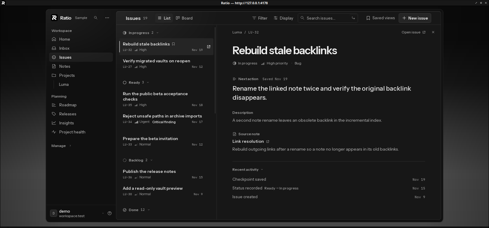

# Ratio 0.3 desktop workspace

At a client size of 1622 × 732, the desktop frame leaves 151 px of background visible on either side. The fade starts near black at the top and reaches its lightest gray along the lower sides. The reading surface stays dark beneath the issue queue and checkpoint. A thin highlight at the upper edge separates the pane from the rail. On phones the outer margin contracts to 5 px.

The issue queue uses one toolbar, plain status headings and a single filled selection. A vertical mark leads from the selected record to its saved checkpoint. Notes, issue details and plots share the same dark surface. Charts use stroke weight, markers and labels to distinguish series. [Issue detail](../../images/ratio-issue-detail.png) · [Insights](../../images/ratio-insights.png)

The desktop ellipsis and F10 open a native menu for Back, Forward, Reload, connection settings and Quit. Removing the permanent menu bar returned 27 px of height to the workspace in the measured Linux installation. [Desktop installation and controls](../../../desktop/README.md)

## Reference gallery

The gallery contains 64 distinct Linear product screenshots from 40 official pages, organized by feature. Each entry identifies its original image and publishing page. Open the HTML gallery from a local checkout for offline browsing. [Gallery](references/index.html) · [Contact sheet](references/overview.jpg) · [Source index](references/sources.csv)

## Render checks

The review covered ten populated views at four widths in both Graphite and Monochrome. The minimum measured text contrast across 4,382 visible samples was 6.60:1 in Graphite and 8.16:1 in Monochrome. At 1622 px, the Issues view went from 21 visible opaque background regions in 0.2.1 to six. The count includes painted elements at least 80 px wide and 20 px tall.

Nine captures from the installed Linux package confirmed that the document occupied the full window client area. Both F10 and the ellipsis opened the native commands. The screenshots above show that installation with the Luma sample workspace. [Desktop verification](../../desktop-verification.md)
